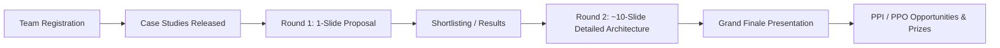

# 🏢 Tata Elxsi & TELIPORT Hackathon Overview

---

## 1. What Kind of Company is Tata Elxsi?

**Tata Elxsi** is a technology + product engineering company within the Tata Group. Unlike traditional IT service consultancies (like TCS/Infosys), Tata Elxsi is design-led and focused heavily on engineering next-generation products, embedded systems, automotive technologies, and digital experiences.

### Key Domains
- 🚗 **Automotive & Transportation**: Software-Defined Vehicles (SDVs), ADAS / Autonomous Driving, AUTOSAR, EV Battery Management Systems (BMS), Infotainment/Cockpit.
- 📡 **Media & Communications**: Telecom network automation, OTT/Video platforms, Android TV, Cloud streaming.
- 🏥 **Healthcare & Life Sciences**: Connected medical devices, digital therapeutics, compliance & validation.

### Tata Elxsi vs Traditional IT Services

| Metric | Tata Elxsi | Traditional IT Services (e.g., TCS) |
| :--- | :--- | :--- |
| **Primary Focus** | Product Engineering, Design, Embedded Software | Enterprise IT, Banking/Finance, Cloud Support, Consulting |
| **Key Domains** | Automotive, Embedded, Media, Healthcare | Broad cross-industry IT enterprise systems |
| **Engineering Stack** | C/C++, Python, Linux/POSIX, AUTOSAR, ROS, AI/ML, GenAI, RTOS | Java/Spring, .NET, Full-Stack CRUD, Cloud Migration |

> [!NOTE]
> Tata Elxsi hires both for standard software roles (Full-stack, Python/Go backend, SRE, AI/ML) and domain-specific systems engineering roles (AUTOSAR, BSP, Linux kernel).

---

## 2. What is TELIPORT?

**TELIPORT** is Tata Elxsi’s flagship national innovation and engineering case-study hackathon. It is structured around real-world industry challenges rather than a rapid 24-hour web CRUD sprint.

### Competition Flow

### Round Breakdown

1. **Round 1 (Idea Pitch - 1 Slide)**:
   - Evaluators judge whether the team truly understands the engineering problem and proposes a viable, technically credible architecture.
   - Requires zero physical hardware at this stage. Focus is on architecture, AI/ML pipeline, system design, and algorithmic novelty.
2. **Round 2 (Detailed Design - ~10 Slides)**:
   - Deep dive into modular architecture, edge case handling, tech stack, OTA/security considerations, and simulation feasibility.
3. **Grand Finale**:
   - Presentation to Tata Elxsi senior technical leadership.

---

## 3. Is TELIPORT Only for Hardware/Embedded Engineers?

**No.** While the domain might be automotive, avionics, or telecom, a large portion of previous winning solutions were **software-first, AI/ML, and systems-architecture** solutions built by Computer Science students.

### Software Topics from Previous Seasons

- **Season 3**: *Predictable Code Development for Service-Oriented Applications using GenAI* (GenAI transforming requirements $\to$ service definitions $\to$ unit tests/code).
- **Season 3**: *AI-Driven SDV Health & Diagnostics* (Predictive AI models, RAG compliance checker, CARLA simulation, telemetry).
- **Season 2**: *GenAI-based solution to accelerate software development for Forward Collision Warning (FCW)* in ADAS.
- **Season 2**: *Drone Jamming Detection & Mitigation* (AI & Signal processing algorithms).

---

## 4. Recommended Team Names Shortlist

- 🥇 **NexForge** *(Recommended: Clean, modern, fits software + engineering without being restricted to one domain)*
- 🥈 **CodeShift**
- 🥉 **CoreSync**
- **LogicForge**
- **VectorX**
