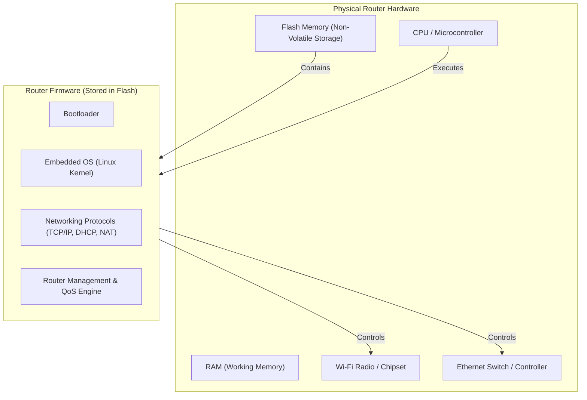
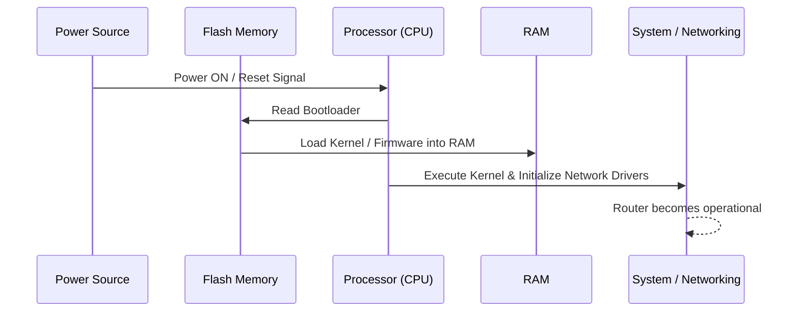

# 🔌 Embedded Systems & Firmware Fundamentals

---

## 1. What is an Embedded System?

An **embedded system** is a specialized computer built inside a larger device to perform a dedicated, specific function rather than general-purpose computing.

$$\text{Embedded System} = \text{Hardware} + \text{Firmware/Software (Dedicated to a specific purpose)}$$

### General Purpose vs Embedded Comparison

| Device | Has a Computer Inside? | Primary Purpose | Examples of Software Run |
| :--- | :---: | :--- | :--- |
| **Laptop / PC** | ✅ | General-purpose computing | Web Browsers, IDEs, Video Games, Office Suites |
| **Smartphone** | ✅ | General-purpose computing | Apps, Games, Browsing, Multimedia |
| **Wi-Fi Router** | ✅ | **Dedicated (Networking)** | Routing packets, NAT, DHCP, Firewall, Wi-Fi drivers |
| **Car ECU** | ✅ | **Dedicated (Vehicle control)** | Engine timing, ABS, ADAS algorithms, sensor polling |
| **Washing Machine** | ✅ | **Dedicated (Appliance control)** | Motor speed cycles, water level sensors, timers |

---

## 2. Anatomy of an Embedded Device (Example: Wi-Fi Router)

A standard Wi-Fi router contains physical computing hardware controlled by dedicated firmware:

---

## 3. What is Firmware?

- **Firmware** is the low-level software permanently or semi-permanently written into a hardware device's non-volatile memory (typically **Flash Memory** or EEPROM).
- **Physical vs Software**: Firmware itself is digital data (compiled binary code), but it is stored in physical flash memory cells on the circuit board.
- **Why Flash Memory?** Flash memory is non-volatile; it retains stored code and configuration even when power is turned off.

### Boot Sequence

### Key Terminology Note
> [!IMPORTANT]
> - Correct phrasing: *"The embedded software is stored in the device as firmware."*
> - Avoid phrasing: *"Software is placed using firmware."*
> - Firmware *is* the software tailored specifically for that hardware.
