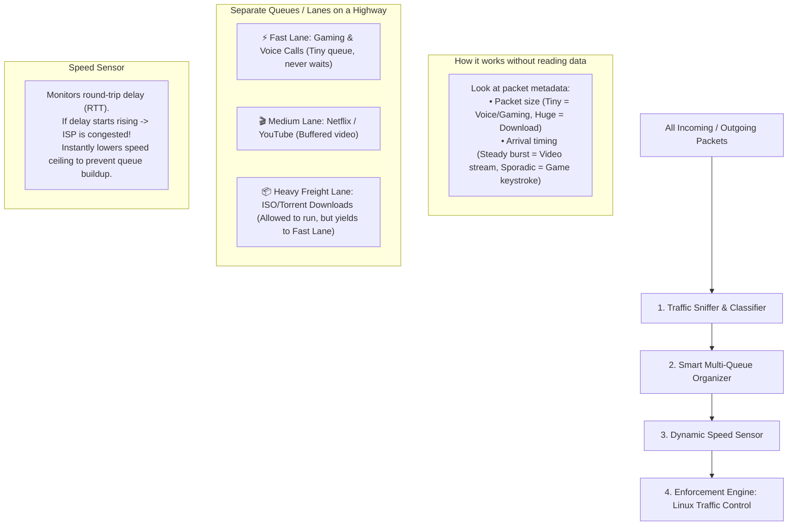

# 🧠 Core Conceptual Breakdown: The Problem & The Solution

> **Target Audience**: Backend Software Engineers & CS Students with Standard Networking Knowledge.  
> **Goal**: 100% clarity so you can understand every line, pitch it confidently, and defend it easily in an interview.

---

## 1. The Real-Life Problem (The "Bufferbloat" Nightmare)

### Imagine Your Home Wi-Fi Right Now:
You have a 100 Mbps internet connection at home. Three things are happening simultaneously:
1. **You** are on an important Zoom/Teams interview call (requires tiny packets, ultra-low delay, $< 30\text{ ms}$).
2. **Your brother** is playing Valorant / CS:GO (requires immediate response, no lag).
3. **Your sister** starts downloading a 50 GB GTA game file or a Windows ISO update (greedy bulk download that wants ALL 100 Mbps).

### What happens in standard Wi-Fi routers today?
- The router has a single "waiting room" (a queue / buffer) for outgoing and incoming packets.
- The 50 GB game download dumps **thousands of massive packets** into the router's waiting room.
- Your tiny Zoom voice packet enters the waiting room, but it is stuck behind 2,000 game download packets!
- **Result**: Even though you have a 100 Mbps line, your Zoom freezes, and your brother’s game ping jumps from $20\text{ ms}$ to $500\text{ ms}$. This phenomenon in networking is called **Bufferbloat**.

---

## 2. Why Can't Normal Routers Just Fix This?

1. **Traffic is Encrypted (HTTPS, TLS, QUIC)**: The router cannot open packets to read `"Oh, this is Zoom voice"` vs `"This is a Steam download"`. Everything looks like encrypted gibberish.
2. **ISP Speeds Fluctuate**: If your ISP suddenly drops from 100 Mbps to 20 Mbps (rain, peak evening hours), the router keeps pushing data as if it has 100 Mbps, making the queue explode with lag.
3. **Static Priority Fails**: If you write a rule: *"Always give Zoom 100% priority"*, the moment a Zoom call starts, your sister's download might stop completely (starvation), or background cloud backups fail.

---

## 3. What Does Tata Elxsi Want Us to Solve?

They want an **Adaptive Quality of Service (QoS) Engine** that:
1. **Figures out what kind of traffic is running** WITHOUT decrypting private data.
2. **Senses if the internet speed suddenly drops** and adjusts automatically.
3. **Organizes the packets into smart separate queues** so gaming/calls never lag, while downloads still keep moving.
4. **Allows a temporary "User Intent"** (e.g., A button in a mobile app / API: *"I have an interview for the next 1 hour, prioritize my laptop"*).

---

## 4. Our Proposed Solution in Backend / CS Terms

Think of our solution like a **Smart Backend Traffic Controller (Load Balancer + Rate Limiter)**:

---

## 5. Translating The Tech Terms into Simple Backend Analogies

| Advanced Term | Simple Backend Analogy | What it actually means |
| :--- | :--- | :--- |
| **Non-Invasive Traffic Classifier** | Feature extraction on metadata | Instead of reading the message body, we look at the envelope's weight and frequency to guess if it's a letter (voice) or a heavy freight box (ISO download). |
| **Linux Traffic Control (`tc`)** | Linux OS Rate Limiter / Shaper | A built-in Linux command tool that creates separate queues and controls bandwidth limits per queue. |
| **Bufferbloat** | Message Queue (RabbitMQ / Kafka) Congestion | When a worker's queue gets clogged with 100,000 slow batch jobs, high-priority instant API requests get stuck waiting. |
| **FQ-CoDel / CAKE** | Smart Fair Queueing Algorithm | An algorithm that gives every active connection its own mini-queue and drops old bloated packets before they cause lag. |
| **Intent-Aware API** | A simple REST API endpoint | A simple POST request: `POST /api/intent {"device": "192.168.1.50", "priority": "high", "duration": 3600}`. |
| **Starvation Prevention** | Fair round-robin scheduling | Ensuring bulk downloads always get at least $5\text{–}10\%$ of the pipe so they don't time out or fail. |

---

## 6. How We Will Pitch This for Round 1

In Round 1, **we do NOT need to write complex C/C++ kernel drivers or train complex deep learning models**. 
We pitch a clean, elegant **Software Architecture**:
1. **Classifier**: A lightweight Decision Tree (or heuristic rule engine) using packet size & inter-arrival time.
2. **Queueing Strategy**: Linux standard `tc-htb` (Hierarchical Token Bucket) + `fq_codel`.
3. **Feedback Loop**: A simple Python daemon monitoring ping latency and dynamically adjusting the `tc` rates.
4. **Intent API**: A lightweight REST API / Web dashboard for the user.
