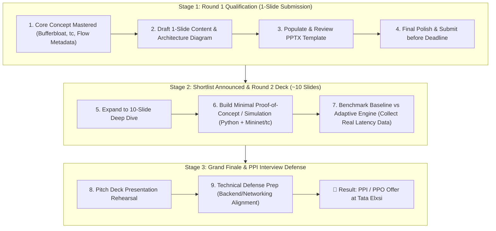

# 🎯 Step-by-Step Strategic Roadmap: From Round 1 to PPI

This roadmap outlines the exact milestone-by-milestone plan to clear **Round 1**, prepare for **Round 2 / Grand Finale**, and secure a **Pre-Placement Interview (PPI)** at Tata Elxsi while playing strictly to your strengths as a backend & software developer.

---

## 🗺️ Visual Roadmap Overview

---

## 📌 Phase 1: Round 1 Strategy (The Immediate Priority)

> **Target**: Create a compelling, professional, technically sound **1-Slide Pitch** that passes the evaluation filter.  
> **Effort**: 100% conceptual clarity & high-quality presentation (No code build required at this stage).

### Step 1: Lock in the 4 Key Slide Sections
To make the 1 slide punchy and executive-ready for Tata Elxsi judges:
1. **Problem Statement & Bottleneck**: Clearly state the Bufferbloat dilemma with mixed traffic + encrypted packets.
2. **Modular Architecture Diagram**: The 4-layer box diagram (Sniffer $\to$ In-Memory State/Redis $\to$ Controller $\to$ Linux `tc` queues).
3. **Core Technical Innovations & Algorithmic Approach**:
   - Non-invasive metadata classification (packet sizes + IAT).
   - Dynamic WAN bottleneck sensing via RTT gradients.
   - Anti-starvation guarantee ($10\%$ minimum bandwidth for bulk).
   - Simple REST Intent API (`POST /api/intent`).
4. **Measurable Verification Metrics**: Before vs After table (Latency reduced from $>250\text{ ms}$ to $<25\text{ ms}$, zero voice jitter).

### Step 2: Fill the PPTX Slide
- Use the official `Teliport S4_Submission Template.pptx`.
- Ensure clean visual hierarchy: concise bullet points, no walls of text, and an easy-to-read architecture block diagram.

---

## 📌 Phase 2: Post-Round 1 (When Shortlisted for Round 2)

> **Target**: Expand from 1 slide to a ~10-slide comprehensive architectural blueprint + lightweight simulated POC.

### Step 3: Expand the Technical Deck (~10 Slides)
- Slide 1: Title & Team Details (Team **NexForge**)
- Slide 2: Industry Problem: Bufferbloat in Modern Mixed Broadband
- Slide 3: End-to-End System Architecture
- Slide 4: Traffic Classification without DPI (Metadata & ML/Heuristics)
- Slide 5: Dynamic Bandwidth Estimation & RTT Feedback Loop
- Slide 6: Intent-Aware Scheduling & Starvation Prevention Matrix
- Slide 7: Linux Traffic Control Implementation (`tc`, `htb`, `fq_codel`)
- Slide 8: API & Web Dashboard Design (Flask/Node + React)
- Slide 9: Experimental Results & Benchmarks (Latency, Jitter, Jain's Fairness Index)
- Slide 10: Production Feasibility & OpenWrt/RDK-B Roadmap

### Step 4: Build a Simple Python/Linux Simulation (Minimal POC)
- You don't need real router hardware!
- Use a Linux VM / WSL2 with `tc` (Traffic Control) + `netem` (Network Emulator to simulate WAN speed drops) + Python scripts to generate traffic (using `iperf3` and `ping`).
- Capture real latency numbers to show in your presentation.

---

## 📌 Phase 3: Interview / PPI Defense Strategy

> **Target**: Convince the technical interview panel that you have deep CS fundamentals and systems design capability.

### Step 5: Speak from Your Backend Strengths
When asked technical questions in the interview:
- Explain the **Intent API** using your experience with **Flask/Node.js REST endpoints and Redis**.
- Explain the **Classifier Fallback** by citing your resilience design in **NirogNet** (offline rule-based fallbacks).
- Explain the **Queueing & Fairness** using core **Operating Systems and Networking concepts** (Priority Queues, Round Robin, MTU, RTT).
